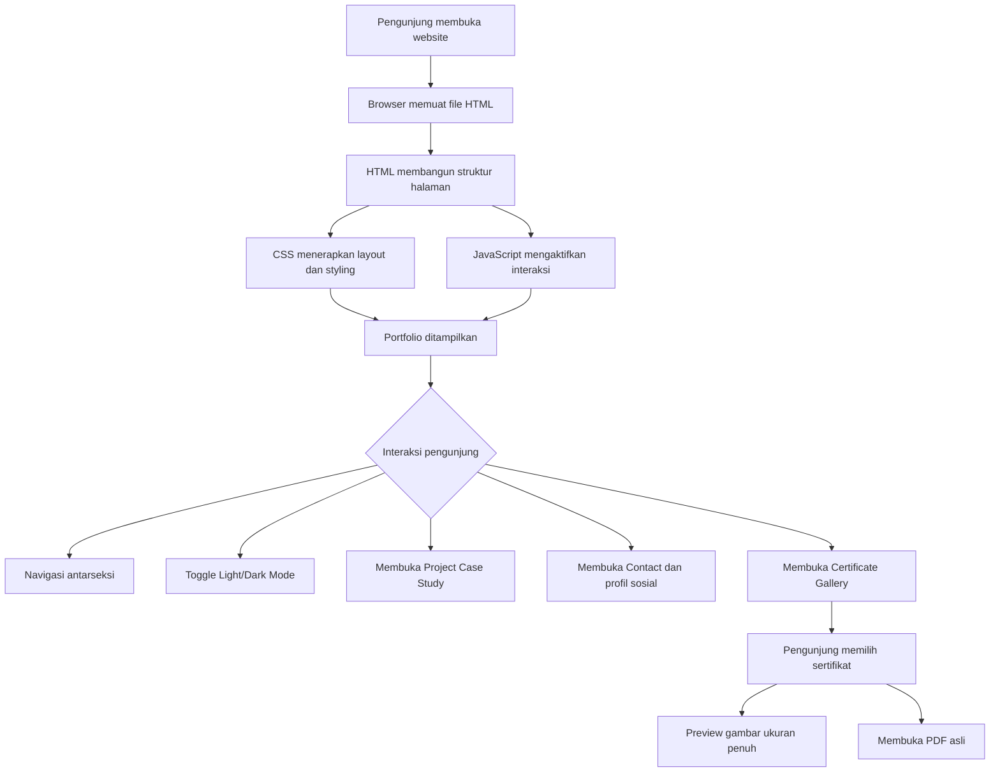

# Alvin Ahmad Kurniawan — Personal Portfolio

Personal portfolio website yang menampilkan profil, pengalaman, proyek teknis, keterampilan, sertifikasi, dan publikasi teknis saya dalam satu halaman web yang responsif dan interaktif.

Website ini dirancang dengan pendekatan minimalis dan modern, dengan dukungan Light Mode dan Dark Mode serta navigasi yang memudahkan pengunjung menjelajahi setiap bagian portfolio.

---

## 1. Project Overview

Portfolio ini berfungsi sebagai representasi digital dari perjalanan akademik, pengalaman profesional, dan pengembangan keterampilan saya di bidang teknologi, khususnya:

- **Network Engineering:** FTTH network planning, broadband network operations, dan infrastruktur jaringan.
- **Cybersecurity:** penetration testing, security fundamentals, dan technical write-ups.
- **Artificial Intelligence:** dasar AI, machine learning, dan pengembangan produk AI.
- **Software Development:** pengembangan aplikasi dan pemrograman.
- **Software-Defined Networking (SDN):** pengembangan sistem Network Intrusion Detection System (NIDS) pada arsitektur Hybrid SDN.

Website ini juga menyediakan akses ke profil profesional, repositori GitHub, artikel Medium, dan dokumen sertifikat yang dapat dilihat oleh pengunjung.

## 2. Features

### 2.1. Personal Introduction

Menampilkan nama, deskripsi singkat, bidang yang diminati, dan navigasi menuju bagian utama website.

Tombol utama pada halaman awal:

- **Explore Projects:** mengarahkan pengunjung ke bagian Projects.
- **Contact Me:** mengarahkan pengunjung langsung ke bagian Contact.

### 2.2. Responsive Navigation

Navigasi membantu pengunjung berpindah antarseksi portfolio, seperti About, Projects, Experience, Certifications, dan Contact.

Tata letak dirancang agar dapat digunakan pada perangkat desktop maupun layar yang lebih kecil.

### 2.3. Light Mode and Dark Mode

Website menyediakan dua pilihan tema tampilan:

- **Light Mode:** menggunakan latar terang dengan kontras teks yang jelas.
- **Dark Mode:** menggunakan latar gelap dengan gradasi warna untuk memberikan tampilan yang lebih nyaman dan konsisten.

### 2.4. Project Case Studies

Bagian Projects menyajikan beberapa proyek dalam bentuk studi kasus. Informasi proyek dapat mencakup:

- Latar belakang dan tujuan proyek.
- Permasalahan atau kebutuhan yang ingin diselesaikan.
- Pendekatan dan proses pengerjaan.
- Teknologi yang digunakan.
- Dokumentasi visual yang tersedia.
- Status pengembangan proyek.

Salah satu proyek utama adalah *Development of NIDS-Based Detection and Mitigation System in a Hybrid Software-Defined Network (SDN) Architecture*, yang masih dalam tahap pengembangan.

### 2.5. Experience and Technical Activities

Bagian Experience merangkum pengalaman kerja praktik, kegiatan organisasi, serta aktivitas teknis yang relevan dengan bidang jaringan, teknologi informasi, dan pengembangan perangkat lunak.

### 2.6. Certificate Gallery

Sertifikat dikelompokkan ke dalam tiga kategori:

1. **Bootcamps & Certifications**
2. **Courses**
3. **Webinars**

Setiap sertifikat ditampilkan melalui kartu yang berisi informasi program dan penyelenggara serta akses ke dokumen sertifikat asli.

Fitur galeri sertifikat meliputi:

- Preview gambar sertifikat.
- Tampilan gambar dalam ukuran besar (*full-size preview*).
- Tombol untuk membuka dokumen PDF asli.
- Kemampuan menutup tampilan besar melalui tombol close, klik di luar gambar, atau tombol `Esc`.

### 2.7. Professional Links and Contact

Pengunjung dapat mengakses profil profesional dan menghubungi pemilik portfolio melalui:

- GitHub
- LinkedIn
- Medium
- Email
- Instagram

---

## 3. Technologies Used

| Technology | Purpose |
|---|---|
| HTML5 | Struktur dan konten halaman website |
| CSS3 | Styling, layout, warna, gradasi, dan responsivitas |
| JavaScript | Interaksi, navigasi, pergantian tema, dan preview sertifikat |
| PDF | Penyimpanan dokumen sertifikat asli |
| Markdown | Dokumentasi proyek melalui README |

Website ini menggunakan pendekatan frontend sederhana dengan HTML, CSS, dan JavaScript. Seluruh implementasi utama berada dalam satu file HTML, sedangkan dokumen sertifikat disimpan dalam folder terpisah.

## 4. Project Structure

Struktur folder paket portfolio:

```text
Alvin_Portfolio_Credentials_v2_Package/
│
├── Alvin_Ahmad_Kurniawan_Portfolio_Credentials_v2.html
├── README.md
│
└── certificates/
    ├── cisco-networking-academy-introduction-to-cybersecurity.pdf
    ├── dicoding-belajar-dasar-ai.pdf
    ├── digistar-digital-application-camp-end-to-end-ml-engineering.pdf
    ├── id-networkers-cyber-security-penetration-testing-bootcamp.pdf
    ├── id-networkers-webinar-ai-assistant-n8n.pdf
    ├── id-networkers-webinar-solusi-praktis-keamanan.pdf
    ├── komdigi-dts-dasar-dasar-implementasi-kecerdasan-artifisial.pdf
    ├── komdigi-dts-hcia-ai-fresh-graduate-academy.pdf
    ├── komdigi-dts-memahami-aspek-pengembangan-produk-ai.pdf
    ├── komdigi-dts-pengenalan-dasar-artificial-intelligence.pdf
    └── x-code-junior-ethical-hacker-v2.pdf
```

*Catatan: nama folder dan file di atas mengikuti struktur paket versi v2. Jika Anda mengubah nama file, sesuaikan pula referensi file di HTML.*

## 5. Program Workflow

Alur kerja website secara umum dapat dijelaskan melalui beberapa tahapan berikut.



### 5.1. Page Rendering

1. Pengunjung membuka file HTML melalui browser.
2. Browser membaca struktur HTML dan membangun elemen halaman.
3. CSS diterapkan untuk mengatur tata letak, tipografi, warna, gradasi, dan responsivitas.
4. JavaScript mengaktifkan fitur interaktif yang tersedia.
5. Browser menampilkan halaman portfolio yang siap digunakan.

### 5.2. Navigation Workflow

1. Pengunjung memilih menu navigasi atau tombol pada halaman utama.
2. Website mengarahkan pengunjung menuju bagian yang sesuai.
3. Konten yang dituju ditampilkan tanpa perlu membuka halaman HTML terpisah.

### 5.3. Theme Switching Workflow

1. Pengunjung menekan tombol pergantian tema.
2. JavaScript mengubah status tema website.
3. CSS menampilkan palet warna sesuai tema aktif.
4. Jika preferensi tema disimpan oleh implementasi, pilihan tersebut dapat digunakan kembali sesuai mekanisme penyimpanannya.

### 5.4. Certificate Viewing Workflow

1. Pengunjung membuka bagian Certifications.
2. Pengunjung memilih kategori sertifikat yang diinginkan.
3. Website menampilkan kartu sertifikat sesuai kategori.
4. Pengunjung mengeklik gambar untuk membuka preview ukuran penuh.
5. Pengunjung dapat menutup preview atau memilih tautan PDF asli.
6. Browser membuka dokumen PDF sesuai lokasi file yang dirujuk oleh HTML.

### 5.5. Contact Workflow

1. Pengunjung menuju bagian Contact.
2. Website menampilkan pilihan kontak dan profil profesional.
3. Pengunjung memilih tautan yang tersedia.
4. Browser membuka tujuan sesuai jenis tautan, misalnya profil GitHub, LinkedIn, Medium, Instagram, atau aplikasi email.

---

## 6. Certificate Classification

Koleksi sertifikat disusun berdasarkan jenis kegiatan agar lebih mudah dipahami pengunjung.

### Bootcamps & Certifications

- Cyber Security Penetration Testing — ID-Networkers.
- Digital Application Camp #2 × Data Science Indonesia: End-to-End ML Engineering: Building Real-World Pipelines & Deploying Models.
- Junior Ethical Hacker v2 — X-CODE.OR.ID.

### Courses

- HCIA AI — Fresh Graduate Academy, Digital Talent Scholarship 2025.
- Pengenalan Dasar Artificial Intelligence — Fresh Graduate Academy, Digital Talent Scholarship 2025.
- Dasar-Dasar Implementasi Kecerdasan Artifisial — Micro Skill, Digital Talent Scholarship 2025.
- Memahami Aspek Pengembangan Produk AI — Micro Skill, Digital Talent Scholarship 2025.
- Belajar Dasar AI — Dicoding.
- Introduction to Cybersecurity — Cisco Networking Academy.

### Webinars

- Solusi Praktis Membangun Sistem Keamanan Dari Nol — ID-Networkers.
- Belajar Membuat AI Assistant dengan N8N — ID-Networkers.

Klasifikasi ini digunakan untuk mempermudah navigasi dan penyajian informasi, bukan sebagai pengganti jenis atau status resmi yang tercantum pada masing-masing sertifikat.

---

## 7. Installation and Usage

Website dapat dijalankan secara lokal tanpa proses instalasi framework frontend.

### Requirements

- Browser modern seperti Google Chrome, Microsoft Edge, Firefox, atau Safari.
- File HTML portfolio.
- Folder `certificates` yang berisi dokumen PDF asli.

### Steps

1. Unduh paket portfolio ZIP.
2. Ekstrak seluruh isi ZIP ke satu folder.
3. Pastikan file HTML dan folder `certificates` berada pada struktur yang benar.
4. Buka file HTML menggunakan browser.
5. Jelajahi bagian portfolio melalui navigasi.
6. Buka bagian Certifications untuk menguji preview gambar dan tautan PDF.

Untuk memastikan seluruh fitur bekerja, periksa tautan sertifikat dan navigasi setelah mengekstrak paket.

## 8. Customization Guide

### Updating Profile Information

Edit teks pada bagian hero, About, Experience, atau Contact di dalam file HTML.

### Adding a New Project

Tambahkan kartu proyek dengan mengikuti struktur dan class CSS yang digunakan oleh kartu proyek lainnya. Isi informasi berdasarkan data proyek yang benar-benar tersedia.

### Adding a New Certificate

1. Simpan PDF sertifikat ke folder `certificates`.
2. Tambahkan entri sertifikat pada bagian kategori yang sesuai.
3. Siapkan gambar preview jika galeri menggunakan gambar terpisah.
4. Pastikan tautan PDF dan referensi gambar mengarah ke lokasi file yang benar.
5. Uji fitur preview ukuran penuh dan pembukaan PDF.

### Changing the Theme

Ubah variabel warna CSS yang relevan untuk menyesuaikan warna latar, teks, aksen, dan gradasi. Periksa kedua tema setelah melakukan perubahan.

---

## 9. Development Notes

- Proyek ini merupakan website portfolio frontend statis.
- Website tidak memerlukan backend khusus untuk menampilkan konten yang sudah tertanam di HTML.
- Pembukaan PDF bergantung pada ketersediaan file lokal dan dukungan browser.
- Jika website dipindahkan ke hosting, pastikan file sertifikat dan aset pendamping ikut diunggah dengan struktur yang sesuai.
- Jangan menambahkan klaim proyek, pencapaian, atau sertifikasi yang belum dapat diverifikasi.
- Sebelum publikasi, periksa kembali informasi pribadi dan dokumentasi yang ditampilkan.

---

## 10. Future Improvements

Beberapa pengembangan yang dapat dipertimbangkan:

- Menambahkan animasi transisi yang ringan dan konsisten.
- Mengoptimalkan ukuran gambar agar halaman lebih cepat dimuat.
- Meningkatkan aksesibilitas keyboard dan screen reader.
- Menambahkan filter atau pencarian proyek.
- Memperbaiki metadata SEO dan preview saat tautan dibagikan.
- Mengembangkan sistem pengelolaan konten apabila jumlah proyek dan sertifikat semakin banyak.

---

## 11. Author

**Alvin Ahmad Kurniawan**

Applied Bachelor of Telecommunication Engineering  
Politeknik Elektronika Negeri Surabaya (PENS)

Areas of Interest:
- Network Engineering
- Cybersecurity
- Backend Development
- Artificial Intelligence
- Software-Defined Networking

Professional Links:

- GitHub: https://github.com/pinnnnn64
- LinkedIn: https://www.linkedin.com/in/alvin-a-kurniawan/
- Medium: https://medium.com/@alvinkurniawan446

---

*This portfolio is intended to present my academic background, technical projects, professional experiences, and continuous learning journey in technology.*
